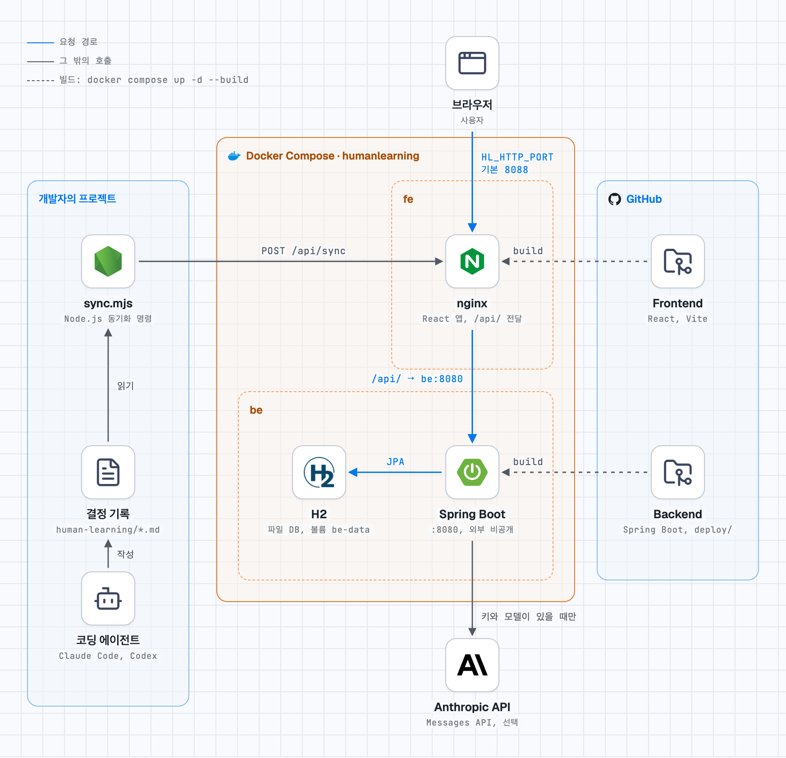

# HumanLearning

AI 코딩 에이전트와 함께 만든 프로젝트인데, 정작 그 코드를 쓴 사람이 왜 이렇게 만들었는지 설명하지 못하는 일이 많습니다. HumanLearning은 에이전트가 개발 중에 내린 설계·구현·검증 결정을 같은 형식의 기록으로 남기게 하고, 그 기록으로 프로젝트 교과서와 기술 교과서를 만듭니다. 개발자는 결정마다 에이전트가 무엇을 골랐을지 먼저 예측하고, 이유를 읽고, 이해한 만큼 표시하며 자기 프로젝트를 설명할 수 있게 됩니다.

2026 Uni-DTHON 해커톤(주제: AI 시대의 격차를 줄이는 기술)에서 만든 프로젝트입니다.

| 저장소 | 내용 |
| --- | --- |
| [Frontend](https://github.com/2026-UniD-Hackathon-Team4/Frontend) | 웹 앱 (React, Vite) |
| [Backend](https://github.com/2026-UniD-Hackathon-Team4/Backend) | REST API (Spring Boot), 결정 기록 스킬(`skill/human-learning/`, `skill/human-learning-retro/`), 통합 배포 구성(`deploy/`) |

두 저장소의 `human-learning/` 폴더에는 HumanLearning을 만들면서 이 스킬로 남긴 결정 기록이 들어 있습니다.

## 사용 흐름

1. 프로젝트에 `human-learning` 스킬을 설치합니다. Claude Code와 Codex가 같은 스킬을 읽습니다.
2. 개발하는 동안 에이전트가 실제 선택지가 둘 이상이던 결정마다 프로젝트 루트의 `human-learning/NNNN-slug.md`에 기록을 씁니다. 기록에는 상황, 검토한 선택지(2~4개)와 장단점, 고른 이유, 얻은 것과 포기한 것, 관련 파일과 줄 범위, 검증한 것과 하지 않은 것, 수준(설계·구현·검증), 중요도, 쓰인 기술과 개념이 들어갑니다.
3. 기록을 앱으로 보냅니다. 터미널에서 스킬의 `sync.mjs`를 실행하거나, 앱의 `프로젝트 불러오기`에서 프로젝트 폴더를 고릅니다. 둘 다 같은 `POST /api/sync` 요청을 보냅니다. 형식에 맞지 않는 기록은 거절 코드와 함께 알려 주고 나머지만 저장합니다.
4. 서버가 기록으로 프로젝트 교과서(프로젝트 목표, 전체 구조, 결정 지도), 기록에 나온 기술마다 기술 교과서(개념 카드), 결정마다 퀴즈를 만듭니다.
5. 사용자는 결정 문서에서 상황과 선택지를 보고 에이전트의 선택을 한 번 예측합니다. 예측한 뒤에 선택, 이유, 트레이드오프, 프로젝트의 코드, 검증 여부가 열립니다.
6. 결정과 개념마다 이해 정도를 표시하고, 원하면 퀴즈를 풉니다. 남은 결정 수와 이해 부채가 함께 바뀝니다.

## 주요 기능

| 기능 | 내용 |
| --- | --- |
| 결정 기록 스킬 | 정해진 형식의 Markdown 기록(YAML front matter와 여섯 절). 한 파일 4,000자 이하 |
| 동기화 | 명령 한 줄 또는 브라우저에서 폴더 선택. 같은 기록을 다시 보내면 바뀌지 않고, 바뀐 기록은 갱신되며 학습 진행은 남습니다. 앱의 불러오기는 창을 닫아도 계속되고 결과를 오른쪽 위 토스트로 알려 줍니다 |
| 프로젝트 교과서 | 프로젝트 목표와 전체 구조, README 요약, 설계·구현·검증으로 나눈 결정 지도, 프로젝트에 쓰인 개념의 개념 지도, 결정별 퀴즈 목록. 다른 결정으로 대체된 결정은 지우지 않고 표시합니다 |
| 결정 문서 | 예측 한 번, 그다음 선택과 이유, 얻은 것과 포기한 것, 기록이 가리키는 코드 줄, 검증한 것과 하지 않은 것. 이해한 정도는 `이해했어요`, `애매해요`, `어려워요`로 표시합니다 |
| 이해 부채 | 아직 이해하지 못한 결정의 중요도 합계(핵심 3, 보통 1, 사소 0). 프로젝트마다 남은 결정 수와 함께 보여 줍니다 |
| 기술 교과서 | 기록에 나온 기술마다 한 권, 영역별로 묶음. 개념 카드(Mermaid 도식), 공식 문서 링크, 그 기술을 쓴 결정으로 가는 링크, 다음에 읽으면 좋은 개념 |
| 개념 학습 | 모든 기술 교과서의 개념 카드를 선행 관계에 따라 층으로 쌓은 지도. 학습 목표를 정하면 거기까지 읽을 순서와 다음에 읽을 개념을 알려 줍니다 |
| 프로젝트 연결 | 프로젝트와 기술 교과서를 선으로 잇는 지도. 여러 프로젝트가 함께 쓰는 기술이 드러납니다 |
| 퀴즈 | 결정마다 객관식 2문항과 자기 설명 1문항. 자기 설명은 채점하지 않고 모범 답안과 빠진 항목을 보여 줍니다. 잘못된 문항은 신고하면 건너뜁니다 |
| 퀴즈 관문 | 설정에서 켭니다(기본 꺼짐). 켜면 아직 열어 보지 않은 결정 가운데 위에 아직 이해하지 못한 핵심 결정이 있는 결정이 잠기고, 그 핵심 결정의 퀴즈를 마쳐야 열립니다 |
| 내용 생성 | Anthropic API 키와 모델을 주면 LLM이 프로젝트 개요, README 요약, 기술 교과서, 퀴즈, 자기 설명의 피드백을 씁니다. 없거나 호출이 실패하면(120초 안에 답이 없을 때 포함) 기록으로 만든 템플릿을 씁니다. LLM이 이미 쓴 교과서 글은 다시 만들다 실패해도 남습니다 |
| 계정 | 이메일과 비밀번호(8~72자)로 가입합니다. 사용자는 자기 프로젝트와 학습 진행만 봅니다. 로그인하지 않은 방문자는 `/`에서 랜딩 페이지를 봅니다 |

## 분석할 수 있는 프로젝트

앱이 분석하는 것은 프로젝트 루트의 `human-learning/` 폴더에 있는 결정 기록입니다. 언어와 프레임워크는 상관없습니다. 기록을 갖추는 길은 두 가지입니다.

| | 개발하면서 기록한 프로젝트 | 기록 없이 완성된 프로젝트 |
| --- | --- | --- |
| 쓰는 스킬 | `human-learning` | `human-learning-retro` (기록 형식과 동기화는 `human-learning`) |
| 기록을 쓰는 때 | 결정한 그 작업 안에서, 코드 변경과 함께 | 완성된 뒤, 저장소를 읽기만 하며 분석해서 |
| 무엇을 골랐는지 | 사실 | 사실 (코드, 설정, 커밋에서 확인) |
| 검토한 대안과 고른 이유 | 결정할 때 에이전트가 실제로 검토한 내용 | AI 추정 (`추정 근거`, `확신도`와 함께) |
| 기록 수 | 결정마다 하나 | 사용자가 고른 후보. 답이 없으면 핵심 결정부터 최대 8개 |
| 앱에서 보이는 모습 | 일반 결정 | 제목이 `[AI 초안]`으로 시작하는 결정 |

### 개발하면서 기록한 프로젝트

- 대상: `human-learning` 스킬을 설치하고 개발한 프로젝트. 에이전트(Claude Code, Codex)가 실제 선택지가 둘 이상이던 결정마다 `human-learning/NNNN-slug.md`를 썼습니다.
- 올리는 방법: 프로젝트 루트에서 `sync.mjs`를 실행하거나, 앱의 `프로젝트 불러오기`에서 프로젝트 폴더를 고릅니다(아래 [결정 기록 스킬](#결정-기록-스킬)).
- 보내는 것: `human-learning/*.md` 기록 원문, 각 기록의 `## Files`가 가리키는 코드 줄(범위마다 최대 40줄), 루트의 `README.md`(앞 20,000자). 그 밖의 파일은 읽지 않고, `.env`·키·자격 증명 같은 비밀 파일은 기록이 가리켜도 열지 않습니다.
- 형식 검사: 형식에 맞지 않는 기록은 거절 코드(`FILE_NAME`, `TOO_LONG`, `FRONT_MATTER`, `ID`, `ENUM`, `TIMESTAMP`, `SECTION`, `OPTIONS`, `CHOSEN`, `CONSEQUENCES`, `VERIFICATION`, `REFERENCES`)와 함께 알려 주고 저장하지 않습니다. 나머지는 저장합니다.
- 다시 올리기: 같은 기록은 `unchanged`, 바뀐 기록은 `updated`로 세고, 사람의 학습 진행은 남습니다.

### 기록 없이 완성된 프로젝트 (`human-learning-retro`)

결정할 때 기록을 남기지 않은 프로젝트에서 결정을 거꾸로 찾아 기록 초안을 만듭니다. 무엇을 골랐는지는 저장소에서 확인한 사실이고, 당시 검토한 대안과 이유는 AI의 추정이라 모든 초안이 스스로 `AI 초안`이라고 밝힙니다.

대상과 읽는 것:

- git 저장소면 커밋 이력에서 결정이 들어온 날짜와 커밋을 찾습니다. git이 없으면 현재 파일만 읽고 날짜는 쓰지 않습니다.
- 의존성: `package.json`, `build.gradle(.kts)`, `libs.versions.toml`, `pom.xml`, `requirements*.txt`, `pyproject.toml`, `go.mod`, `Cargo.toml`의 이력에서 의존성이 들어오고 빠진 날짜와 커밋
- 설정과 인프라: Dockerfile, compose, GitHub Actions·GitLab CI·Jenkins, Terraform, nginx, Vercel·Netlify·Fly·Render, Spring `application*.yml`, 프론트엔드 빌드 설정, `tsconfig`, Prisma, 마이그레이션·k8s·Helm 폴더
- 그 밖에 README와 문서, 폴더 구조, 구성을 바꾼 커밋. 이 목록 밖의 언어도 에이전트가 코드를 직접 읽어 분석하지만, 의존성 이력은 자동으로 모으지 않습니다.

순서:

1. 기록할 프로젝트에 두 스킬을 설치합니다. `<Backend 저장소>`는 Backend 저장소를 받은 폴더입니다.

```bash
for skill in human-learning human-learning-retro; do
  for dir in .claude/skills .agents/skills; do
    mkdir -p "$dir/$skill" && cp <Backend 저장소>/skill/$skill/SKILL.md <Backend 저장소>/skill/$skill/*.mjs "$dir/$skill"/
  done
done
```

2. 에이전트에게 `human-learning-retro` 스킬로 결정 기록 초안을 만들어 달라고 요청합니다. 에이전트는 `retro.mjs scan`으로 증거를 모으고 코드와 문서를 직접 읽습니다. 저장소는 읽기만 하며 빌드, 설치, 실행, 체크아웃, 커밋을 하지 않습니다.
3. 에이전트가 결정 후보를 근거(파일 줄, 커밋)와 함께 번호 목록으로 보여 주면 사용자가 고릅니다. 답이 없으면 핵심(`core`) 후보부터 최대 8개를 고르고, 고른 것과 뺀 것을 보고합니다.
4. 에이전트가 고른 후보마다 초안을 씁니다. `chosen`과 `## Files`는 사실로, 대안과 이유는 추정으로 쓰고, 날짜는 결정이 들어온 커밋의 시각으로 씁니다. 바뀐 결정(빠진 의존성, 교체 커밋)은 기록 두 개와 `supersedes`로 남깁니다. 이미 있는 기록은 고치지 않습니다.
5. `retro.mjs check`가 초안 표시, 파일 이름, 길이, `## Files` 범위, 비밀 값을 검사합니다(`NAME`, `LENGTH`, `MARK`, `CONFIRM`, `ORIGIN`, `FILES`, `SECRET`). 종료 코드 0일 때만 `sync.mjs`나 `프로젝트 불러오기`로 올립니다.

```bash
node .claude/skills/human-learning-retro/retro.mjs scan     # 증거 모으기 (읽기 전용)
node .claude/skills/human-learning-retro/retro.mjs check    # 초안 검사. 0이면 통과
HL_EMAIL=<앱 계정 이메일> HL_PASSWORD=<앱 계정 비밀번호> node .claude/skills/human-learning/sync.mjs --url <앱 주소>
```

앱에서는 초안이 일반 기록과 같은 화면에 이렇게 보입니다.

```text
[AI 초안] 문서 임베딩을 PostgreSQL의 pgvector에 저장한다
AI 초안: 완성된 코드와 커밋 이력에서 AI가 추정한 기록이다. 선택지는 나중에 조사한 대안이고, 고른 이유는 사람이 확인하지 않은 추정이다.
추정 근거: 커밋 a1b2c3d가 build.gradle에 PostgreSQL 드라이버와 pgvector를 함께 추가했다
확신도: 중간 — 이유를 말하는 문서는 없고, 설정이 DB 하나짜리 구성을 보여 준다
```

- 에이전트의 선택을 예측하는 학습은 그대로 씁니다. 무엇을 골랐는지는 사실이기 때문입니다.
- 이유는 `확신도`(높음: 커밋·문서가 이유를 직접 말함, 중간: 코드와 설정이 뒷받침함, 낮음: 일반 지식으로 추정)를 보고 믿을 정도를 정합니다. `낮음`은 그 기술의 일반적인 장단점 공부로만 씁니다.
- 확정: 사람이 당시 선택지와 이유를 알려 주면 초안을 고쳐 `origin: ai-retro-confirmed`로 바꾸고 초안 표시를 지운 뒤 다시 올립니다. 앱은 그 결정을 `updated`로 세고 퀴즈를 새로 만들며, 학습 진행은 남깁니다.
- 그 뒤에 내리는 결정은 `human-learning` 스킬로 결정할 때 바로 기록합니다. 번호는 초안 다음부터 이어집니다.

### 올린 뒤 분석되는 방식 (두 경우 같음)

서버는 프로젝트 폴더를 직접 읽지 않고, 받은 기록·코드 줄·README만으로 아래를 만듭니다. Anthropic API 키와 모델이 있으면 LLM이 쓰고(동시에 최대 4개 호출), 없거나 호출이 실패하면 기록으로 만든 템플릿이 그 항목을 씁니다.

| 받은 것 | 만들어지는 것 | 앱에서 보는 곳 |
| --- | --- | --- |
| 기록 전체의 제목, 요약, 수준 | 프로젝트 교과서의 목표와 전체 구조 | 프로젝트 문서 |
| `README.md` | 프로젝트 요약 2~4문장 (템플릿이면 README의 첫 산문 문단 400자) | 프로젝트 문서의 목표 아래 |
| 기록의 `level`, `importance`, `parent`, `supersedes`, `timestamp` | 설계·구현·검증으로 나눈 결정 지도와 시간순 보기, 바뀐 결정 표시, 이해 부채의 무게(핵심 3, 보통 1, 사소 0) | `결정 지도` |
| 결정 하나의 상황, 선택지, 이유, 얻은 것과 포기한 것, 검증 | 예측 뒤에 열리는 결정 문서, 퀴즈 3문항(고른 이유, 다른 선택지라면 달라지는 것, 자기 설명) | 결정 문서, `퀴즈` |
| `## Files`의 코드 줄 | 결정 문서 안의 코드 (없는 파일은 `파일 없음`) | 결정 문서 |
| 기록의 `technologies`와 개념 이름 | 기술마다 기술 교과서(무엇인가, 푸는 문제, 공식 문서 링크)와 개념마다 카드(정의, 설명, Mermaid 도식, 선행 개념). 사용자의 모든 프로젝트가 함께 씁니다 | `기술 교과서`, `개념 학습`, 프로젝트의 `개념 지도` |
| 여러 프로젝트의 같은 기술·개념 | 프로젝트와 기술 교과서를 잇는 지도, 개념마다 쓰인 프로젝트 수 | `프로젝트 연결` |

- LLM이 켜져 있으면 결정 기록의 내용, README, 자기 설명 답이 Anthropic API로 나갑니다. 보내기 전에 32자 이상 이어진 키 모양 문자열은 `[masked]`로 가립니다.
- LLM 생성은 기록 수에 비례해 시간이 걸립니다. 호출은 결정마다 퀴즈 하나, 프로젝트 개요 하나, README 요약 하나이고, 새 기술마다 소개 하나와 개념 카드 3장당 하나가 더해집니다. 동시에 최대 4개씩 보내고, 120초 안에 답이 없는 호출은 템플릿으로 대신합니다. 앱의 불러오기 창은 기록 n개를 호출 `2n + 2`개로 어림해 보통 `올림((2n+2)/4) × 10초`, 길면 `× 30초`로 안내합니다. 템플릿으로 대체된 항목은 동기화 결과(`sync.mjs`의 `fallback` 줄, 앱의 불러오기 결과)에 나오고, 다시 올리면 생성을 다시 시도합니다.

## 구조

| 영역 | Frontend | Backend |
| --- | --- | --- |
| 언어와 런타임 | TypeScript 5.9, React 19 | Java 21, Spring Boot 4.1 |
| 빌드 | Vite 7, pnpm | Gradle (Kotlin DSL, 래퍼 포함) |
| UI와 데이터 | Tailwind CSS 4, shadcn/ui, React Router 7, TanStack Query 5, Mermaid 12 | Spring Web MVC, Spring Data JPA, Bean Validation |
| API | openapi-typescript로 생성한 타입과 openapi-fetch | springdoc OpenAPI (`/v3/api-docs`, `/swagger-ui.html`), 오류는 RFC 9457 `application/problem+json` |
| 인증 | access token 하나를 `localStorage`에 저장 | Spring Security(stateless), JWT HS256(jjwt), BCrypt |
| 저장소 | | H2 파일 DB(기본), PostgreSQL(`postgres` 프로파일) |
| 테스트 | Vitest 4, Testing Library, MSW 2 | JUnit, `@SpringBootTest`와 MockMvc |
| 컨테이너 | `node:24-alpine`에서 빌드, `nginx:1.30-alpine`으로 서빙 | `eclipse-temurin:21-jdk`에서 빌드, `eclipse-temurin:21-jre`로 실행 |

아래 그림은 Docker Compose로 배포했을 때의 구성입니다.

<picture>
  <source media="(prefers-color-scheme: dark)" srcset="assets/deployment-dark.png">
  
</picture>

<sub>아이콘: svgl(nginx, Node.js, Docker, GitHub, Anthropic), Lucide, spring.io(Spring Boot), h2database/h2database(H2). 로고의 상표권은 각 소유자에게 있습니다. 그림의 원본은 [`assets/deployment.html`](assets/deployment.html)이며 stack-diagram으로 만들었습니다.</sub>

## 통합 배포 (Docker Compose)

`Backend` 저장소의 `deploy/compose.yaml`이 호스트 한 대에서 두 저장소를 빌드하고 함께 띄웁니다. `fe` 컨테이너(nginx)가 웹 앱을 서빙하고 `/api/`를 `be` 컨테이너로 넘깁니다. `be`는 포트를 공개하지 않아 compose 네트워크 안에서만 닿습니다. 두 이미지는 Docker 안에서 빌드되므로 호스트에 Java와 Node.js는 필요 없습니다.

1. 준비: compose 플러그인이 있는 Docker(`docker compose` 명령)와 git.
2. 빈 폴더에서 두 저장소를 `be`, `fe`라는 이름으로 나란히 클론합니다. compose 파일은 `be/deploy/`에서 `..`(백엔드)와 `../../fe`(프론트엔드)를 빌드합니다.

   ```bash
   git clone https://github.com/2026-UniD-Hackathon-Team4/Backend.git be
   git clone https://github.com/2026-UniD-Hackathon-Team4/Frontend.git fe
   ```

   ```text
   <작업 폴더>/
   ├── be/
   │   └── deploy/
   │       ├── compose.yaml
   │       └── .env.example
   └── fe/
   ```

3. 환경 변수 파일을 만들고 값을 채웁니다. `be/deploy/.env`는 git이 무시하는 파일이고, 절대 커밋하지 않습니다. 같은 이름을 셸에서 export해도 됩니다.

   ```bash
   cp be/deploy/.env.example be/deploy/.env
   ```

   | 변수 | 필수 여부 | 뜻 |
   | --- | --- | --- |
   | `JWT_SECRET` | 필수 | 로그인 토큰의 서명 키, 32바이트 이상. 예: `<32자 이상의 임의 문자열>`(`openssl rand -base64 48`로 만들 수 있음). 없으면 compose가 시작을 거부합니다 |
   | `HL_ALLOWED_ORIGINS` | 선택, 기본 `http://localhost:5173` | CORS가 허용할 출처, 쉼표로 구분. 앱을 여는 주소로 둡니다. 예: `http://localhost:8088`, 리버스 프록시 뒤라면 `https://<공개 도메인>`(경로 없이). 예시 파일의 값은 예시 도메인이므로 바꿉니다 |
   | `HL_HTTP_PORT` | 선택, 기본 `8088` | `fe`의 호스트 포트. 유일하게 공개되는 포트입니다 |
   | `JWT_EXPIRES_IN_SECONDS` | 선택, 기본 `86400` | 토큰 만료 시간(초) |
   | `ANTHROPIC_API_KEY` | 선택 | `<Anthropic API 키>`. `ANTHROPIC_MODEL`과 둘 다 있을 때만 LLM이 내용을 씁니다. 이때 결정 기록의 내용과 자기 설명 답이 Anthropic API로 전송됩니다(키 모양 문자열은 가린 뒤) |
   | `ANTHROPIC_MODEL` | 선택 | `<Anthropic 모델 이름>`. 둘 중 하나라도 비면 기록 템플릿이 모든 내용을 씁니다 |

4. 빌드하고 시작합니다.

   ```bash
   cd be/deploy && docker compose up -d --build
   ```

   `be`가 healthy가 되면(Spring이 `/actuator/health`에 답하면) `fe`가 시작됩니다.

5. 확인합니다. `be/deploy`에서 `docker compose ps`로 `be`가 healthy인지 보고, 호스트에서 아래 명령을 실행합니다. `401`이 나오면 `fe`를 거쳐 `be`까지 닿은 것입니다(로그인하지 않은 요청이라 401). `HL_HTTP_PORT`를 바꿨다면 8088 대신 그 값을 씁니다.

   ```bash
   curl -s -o /dev/null -w '%{http_code}\n' localhost:8088/api/me
   ```

6. 브라우저에서 `http://<호스트>:<HL_HTTP_PORT>`(기본 `http://<호스트>:8088`)를 열고 `/signup`에서 가입한 뒤 로그인합니다. 예제 기록을 넣어 보려면 `프로젝트 불러오기`에서 `be/fixtures/shop` 폴더를 고릅니다(폴더 선택은 데스크톱 브라우저에서만 됩니다).

리버스 프록시: 프록시(예: Nginx Proxy Manager의 proxy host)는 `http://<호스트>:<HL_HTTP_PORT>`를 가리키게 하고 8080 포트는 가리키지 않습니다. LLM 키가 있으면 동기화가 몇 분 걸릴 수 있으니 프록시의 읽기 타임아웃도 길게 둡니다(`fe`의 nginx는 600초). 바꾼 변수는 `be/deploy`에서 `docker compose up -d`로 반영됩니다.

업데이트: 작업 폴더에서 실행합니다.

```bash
git -C be pull && git -C fe pull
cd be/deploy && docker compose up -d --build
```

멈추기: `be/deploy`에서 실행합니다.

| 명령 | 결과 |
| --- | --- |
| `docker compose stop` | 컨테이너를 멈추고 남겨 둡니다. 데이터 유지 |
| `docker compose down` | 컨테이너를 지웁니다. 볼륨과 데이터 유지 |
| `docker compose down -v` | 볼륨까지 지웁니다. 모든 계정, 기록, 학습 진행이 사라집니다 |

데이터: H2 파일 DB는 이름 있는 볼륨 `humanlearning_be-data`에 있고 `be` 컨테이너의 `/data`에 마운트됩니다(`docker compose -p <프로젝트>`로 띄웠다면 `<프로젝트>_be-data`). `restart`, `stop`, `down`, `up -d --build`를 해도 남으므로, 데이터를 지키려면 `down -v`만 쓰지 않으면 됩니다.

## 로컬 개발

백엔드(Java 21 필요, Gradle은 래퍼로 포함):

```bash
cd be
./gradlew bootRun   # http://localhost:8080, H2 파일 ./data/humanlearning (HL_DB_FILE로 변경)
./gradlew test      # H2 인메모리
```

로컬 실행의 환경 변수는 모두 선택입니다. 필요하면 `cp .env.example .env`로 만든 뒤 `set -a; source .env; set +a`로 읽고 `bootRun`합니다. API 문서는 `http://localhost:8080/swagger-ui.html`에 있습니다.

프론트엔드(Node.js 20 이상, pnpm 필요):

```bash
cd fe
pnpm install
pnpm dev        # http://localhost:5173, /api는 http://localhost:8080으로 프록시 (백엔드 실행 필요)
pnpm dev:mock   # 백엔드 없이, 브라우저 안의 MSW 모의 서버가 /api/*에 응답
```

백엔드의 CORS 기본값이 `http://localhost:5173`만 허용하므로 개발 서버는 5173 포트를 고정해서 씁니다. 검사: `pnpm typecheck`, `pnpm lint`, `pnpm test`, `pnpm build`. 백엔드 API가 바뀌면 `pnpm gen:api`(실행 중인 백엔드에서)나 `pnpm gen:api:local`(저장소의 `openapi.json`에서)로 타입을 다시 만듭니다.

## 결정 기록 스킬

설치: `Backend` 저장소의 `skill/human-learning/` 폴더(아래의 `<스킬 폴더>`)에 있는 `SKILL.md`와 `sync.mjs`를 기록할 프로젝트의 두 위치에 복사하고, 프로젝트의 `CLAUDE.md`와 `AGENTS.md`에 `기술적 결정이 생기면 human-learning 스킬로 기록한다` 한 줄을 넣습니다.

```bash
for dir in .claude/skills/human-learning .agents/skills/human-learning; do
  mkdir -p "$dir" && cp <스킬 폴더>/SKILL.md <스킬 폴더>/sync.mjs "$dir"/
done
```

동기화: 기록할 프로젝트의 루트에서 실행합니다. Node.js만 있으면 되고 의존성은 없습니다. 앱 계정은 셸 환경 변수로만 넘기고 기록이나 파일에 적지 않습니다.

```bash
HL_EMAIL=<앱 계정 이메일> HL_PASSWORD=<앱 계정 비밀번호> node .claude/skills/human-learning/sync.mjs --url http://localhost:8088
```

| 입력 | 뜻 |
| --- | --- |
| `--url URL` 또는 `HL_URL` | 서버 주소. 기본값 `http://localhost:8080`(로컬 `bootRun`). 배포한 앱이면 그 공개 주소 |
| `HL_EMAIL`, `HL_PASSWORD` | 앱에서 가입한 계정 |
| `--project NAME` | 앱에 보일 프로젝트 이름, 영문·숫자·`.`·`_`·`-`로 80자 이하. 기본값은 현재 폴더 이름 |
| `--dry-run` | 보내지 않고 보낼 요청 JSON만 출력 |

명령은 `human-learning/*.md`, 각 기록의 `## Files`가 가리키는 코드 줄(한 범위에 최대 40줄), 루트의 `README.md`(앞 20,000자)를 보냅니다. 비밀 파일은 기록이 가리켜도 열지 않습니다. 출력 첫 줄은 `created {n}, updated {n}, unchanged {n}, rejected {n}`이고, 거절된 기록이 있으면 종료 코드 2, 로그인이나 네트워크 오류면 종료 코드 1로 끝납니다. 기록 형식, 거절 코드, 비밀 정보 규칙은 [`SKILL.md`](https://github.com/2026-UniD-Hackathon-Team4/Backend/blob/main/skill/human-learning/SKILL.md)에 있습니다.

## 라이선스

두 저장소 모두 MIT 라이선스입니다.
